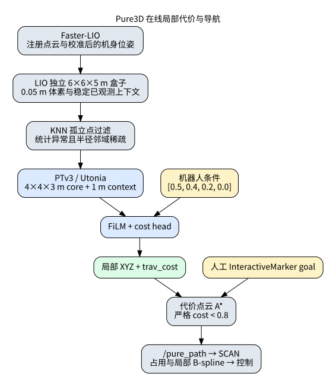

# Pure3D 当前网络与在线数据流

更新日期：2026-11-17。

当前在线链路为 Faster-LIO → 稳定体素上下文 → KNN → PTv3 + cost head → A* → SCAN。Filter 保留为独立训练与离线推理模块。各模型使用各自训练的编码器和任务头，当前在线入口不调用学习式 Filter。

## 在线局部预测

1. `/faster_lio/cloud_registered` 提供 `camera_init` 中的注册扫描。Entry 经固定 `world ← camera_init` 转换接收。
2. `/faster_lio/Odometry` 的机身位姿独立维护世界轴向 `6×6×5 m` 盒子，不等待 SCAN 更新盒子。
3. 以 `0.05 m` 体素保留已观测坐标。编码使用 `4×4×3 m core + 1 m context`，保留当前 core 所需的完整已观测上下文。
4. KNN 在编码前删除统计异常且半径邻域稀疏的孤立点。该步骤不使用预测 cost 或教师几何。
5. 常驻 GPU worker 编码保留点，FiLM / cost head 使用条件 `[clearance_min,slope_max,step_max,stand_ratio]`。当前条件为 `[0.5,0.4,0.2,0.0]`。
6. `/entry/local/cost_cloud` 输出盒内保留点的 XYZ 与 `trav_cost`。模型缓存按实际编码输入复用，显示点云单独降采样。

没有观测点的区域保持未知。KNN 改变输入点集后重新编码，不能将删除后的旧预测当作过滤上下文后的新预测。

## 路径与控制

模式 4 由人工 InteractiveMarker 提供 `/scan/goal`。每次目标位置改变触发一次 cost-cloud A*，严格采用 `0 ≤ cost < 0.8`，无可用路径时保持停车。A* 经 `/pure_path` 交给 SCAN，SCAN 使用自己的占用图和局部 B-spline 优化，并持续重规划。

SCAN 局部优化沿用现有实现，A* 的 cost 上限没有被描述为 SCAN 轨迹约束。重规划采用共享 `0.5 s` 墙钟预算，在循环和阶段边界检查超时。

静态 `planner` 工具保留 `dc` 与 `surface` 后端及 A* → GPMP，可独立比较，不改变在线模式 4 的 A* → SCAN 流程。

## 独立训练

Filter 输出原始点序的 `keep_score`，用于点的保留判断。Traversability 输出 `[0,1]` 归一化地形代价。两种标签分别训练。`keep_score` 低表示观测可疑，不能直接等同于低通行代价。

VST 生成条件化 cost 教师标签，学生条件和教师参数对应关系见 [参数映射](TEACHER_STUDENT_PARAMETERS.md)。模型效果、静态规划可达性和机器人实际执行分别记录。

## 实现位置

- [Entry 接口与模块](../common/README.md)
- [局部 cost 与 KNN](../common/cost/docs/LOCAL_COST.md)
- [纯 A* 跟随](../common/planning/docs/PURE_PATH_FOLLOW.md)
- [Traversability 训练与推理](../utils/Traversability/README.md)
- [Filter 训练与推理](../utils/Filter/README.md)
- [真机安装与迁移](REAL_WORLD_SETUP.md)
