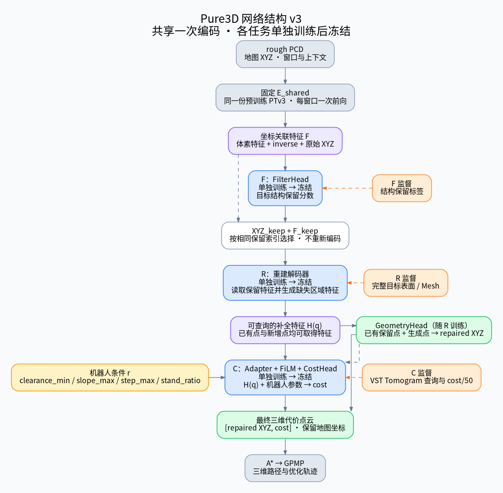

# Pure3D 网络结构 v3：共享编码，分阶段训练与冻结

更新日期：2026-11-12。当前 R 采用连续大地形的整图 Subtraction，再提取固定核心／上下文块，使用 PTv3 条件 Flow Matching，不含语义条件。实现与验收见 [RECON](../Reconstruction/README.md)。当前输出止于补全 PCD。下文 H(q) → Cost 是后续方案，尚未串接。已有 Traversability 权重与 planner 保留。

用户决定：各任务单独训练，完成后冻结再连接。为减少推理的重复计算，共用同一份固定的点云编码器，后续任务在冻结前级的真实输出上训练。整条感知链分阶段训练，运行时一次调用完成，A* → GPMP 继续使用最后的代价点云。

## 1. 运行时的数据流

```text
rough XYZ [N,3]
    → E_shared：同一份固定的预训练 PTv3，每窗口编码一次
    → 坐标关联特征 F
        ├─ FilterHead(F + 局部几何统计) → keep_score [N,1]
        └─ 按保留索引取得 XYZ_keep 与 F_keep
                  → ReconDecoder(F_keep, XYZ_keep, 空间查询)
                  → 可查询的补全特征 H(q)，候选接口宽度 128
                        ├─ GeometryHead → 新 XYZ，与 XYZ_keep 合并得到 P_repaired
                        └─ H(P_repaired) → Adapter → FiLM(r) → CostHead → cost
    → [P_repaired, cost]，地图原点下的完整三维代价点云
    → A* → GPMP
```

模块间传递的是“空间坐标 + 与坐标关联的特征”，保存中间 PCD 仅用于检查与导出。过滤后保留点的特征直接取自 F，不再把 filtered.pcd 送入第二个 PTv3。重建负责为新增坐标产生 H，新点和已有保留点均能取得 cost 所需特征。

这保留功能上的 filter → recon → cost 顺序。各阶段参数分别训练并冻结，不要求后级损失反传至前级。由于 FilterHead 已在 R 阶段冻结，保留索引可以使用硬阈值，首版不必引入软过滤来打通梯度。



## 2. 固定的特征接口

| 接口 | 内容 | 使用者 |
|---|---|---|
| `encode(raw)` | 体素坐标、features、inverse、原始 XYZ 与窗口变换 | Filter、Recon 的共同起点 |
| `filter(features, geometry)` | 每个原始点的 keep_score、保留索引 I | 选择原始 XYZ 和对应特征 |
| `select(I)` | XYZ_keep 与 F_keep，保留相同的点行映射 | ReconDecoder |
| `reconstruct(XYZ_keep, F_keep)` | 可查询的 H，以及几何生成所需输出 | GeometryHead 与 CostHead |
| `query_features(q)` | 任意三维位置 q 对应的 H(q)，候选宽度 128 | 训练 Tomogram 查询及部署全部输出点 |
| `predict_cost(H(q), r)` | 每个查询位置的归一化 cost | 最终代价点云 |

编码器只在已有观测处提供直接特征，新增点的特征由重建器产生。`query_features(q)` 不能只覆盖已导出的生成点列表，因为 cost 的训练查询来自 Tomogram，与输出 PCD 点集不同。候选重建器必须支持任意位置查询，例如空间特征场插值或查询条件化 MLP。

R 当前采用固定空间 latent、条件 Flow Matching、表面分类及坐标偏移，详见 [RECON 架构](../Reconstruction/docs/ARCHITECTURE.md)。Seen2Scene 仅作为参考，完整 Mesh 是唯一 GT。内部空间特征用于几何查询，Cost 特征接口延后。

## 3. 训练顺序

| 阶段 | 本次训练的参数 | 固定的参数 | 输入来自哪里 | 完成后 |
|---|---|---|---|---|
| S0：固定公共底座 | 无 | 预训练 E_shared | rough PCD | 确定共同特征空间与版本 |
| F：过滤 | FilterHead 及自身投影 | E_shared | E_shared(raw) 的真实特征 | 选择并冻结 FilterHead |
| R：重建 | ReconDecoder、GeometryHead 及其投影 | E_shared、FilterHead | 冻结 Filter 的实际保留 XYZ + 特征 | 选择并冻结重建模块 |
| C：代价 | Adapter、FiLM、CostHead | E_shared、FilterHead、ReconDecoder、GeometryHead | 冻结重建器在 Tomogram 位置产生的 H(Q_gt) | 冻结代价头并连接推理 |

同一时刻只训练一个阶段。不安排后续联合微调作为必需步骤。各阶段的轮数待样本与短训练结果确定，不继续使用旧 v2 的 F=10/R=90 总计 100 轮安排。

公共底座先使用固定的官方 Utonia 权重，Tiny 用于本地实现，Small 用于主实验比较。编码器在 F/R/C 全程 `requires_grad_(False)` 并处于 `eval()`，既不更新权重，也不改变统计量或随机失活行为。活动任务头单独 `train()`。公共底座若以后改变，后级必须重新适配并重建缓存。

这里的“一次编码”指每个空间窗口的一次 PTv3 前向。整栋建筑仍按窗口处理，重建解码、查询与融合仍有计算开销，提速幅度需要实际测量。

## 4. 三阶段的监督

### F：目标结构保留

FilterHead 输出连续保留系数 keep_score，训练目标由目标身份与观测质量定义，使用连续目标回归。主体地面、墙、顶面、楼梯、斜坡、栏杆、柱梁以及约定保留的规则障碍获得相应高质量目标。用户在 ROT stair 图中指定的外围漂浮扫描残片、非目标物体及伪影为低保留目标，即使局部形状像墙面或栏杆也如此。KNN/密度统计只作为特征，不另设几何删除规则。具体监督和损失见独立模块的 [Filter 设计](../Filter/docs/ARCHITECTURE.md)，文件分类与 Traversability 一致。

### R：完整表面重建

R 阶段读取实际 F_keep，不用 GT 筛点替代预测过滤。完整 Mesh 提供缺损区的表面目标，真实门洞、楼梯井和栏杆间隙仍为空。首个候选保留已有点，追加生成的表面点。

先训练完整块的几何自编码，再训练带课程和终点几何监督的条件 Flow Matching。入口使用实际 F_keep，当前最终输出补全点云。训练与验证状态见 [Reconstruction](../Reconstruction/README.md)。

### C：机器人条件化代价

机器人条件固定为 `r=[clearance_min,slope_max,step_max,stand_ratio]`，教师 interval_free 为 0.5 m。VST 原生 Tomogram 提供 `Q_gt=[x,y,ground]` 和 `C_gt=cost/50`。

C 阶段冻结几何链，在 Q_gt 查询 H，再训练 Adapter → FiLM(r) → CostHead。Tomogram 仅提供监督查询位置与代价，不进入编码器或重建器输入，不使用教师特征代替 H。

部署在 P_repaired 的每个 XYZ 查询同一个 H，预测每点归一化 cost。修改机器人参数时复用 H，仅重跑条件化代价头。

## 5. 缓存与训练一致性

- F 阶段可以缓存 E_shared 的输出。
- F 固定后，R 阶段缓存预测 keep_score、保留索引及 F_keep，重复 epoch 不重跑冻结底座和过滤头。
- R 固定后，C 阶段缓存 H(Q_gt)，同一几何特征供多组机器人条件使用。
- 缓存记录对应的上游权重版本、点行映射、体素格网、坐标和窗口变换。
- 绕 Z 旋转或几何退化会改变编码特征。需要为相应变体重新提取或预缓存，不能只旋转 XYZ 就假设旧 PTv3 特征仍等价。

固定前级只省去训练时的梯度与可重复计算。最终推理仍需执行一次 E_shared、一次重建及轻量 heads。把三套独立编码器分别冻结不会自动减少前向次数。

## 6. 现有 cost 权重如何处理

现有 CostModel 已训练，其实际实现是自己的 E_cost、局部/全楼查询聚合、FiLM 和 CostHead，见 [Traversability/models/model.py](../Traversability/models/model.py)。它继续作为独立可用基线，旧权重不修改。

新共享架构中 CostHead 接收的是 H，而不是原 E_cost 的查询特征。即便通道维数相同，分布也不相同，因此 C 阶段需要单独训练适配器和代价头。旧 head 权重可作为初始化候选，不假定直接连接并冻结后仍有相同精度。

本版是新的共享特征改造计划，不表示现有 cost 代码已实现该接口。

## 7. 输出与规划

`P_cost=[x,y,z,cost]` 保留地图原点、米制 XYZ 与 `[0,1]` cost。保留点与生成点的来源作为旁路属性保存。PCD、日志、预测和图仍放在 runs 中，权重每个阶段只保留 best.pt 与 last.pt。

训练阶段可各自保存一个 run，部署组合固定的 E_shared、F、R、C 权重。部署包记录各阶段版本，避免混用不同特征接口。组合成一个 checkpoint 是文件组织，不额外增加一个训练阶段。

规划采用纯PCD的DC表面图，默认增加机器人条件化跨阶边，保留无跨阶边作为唯一消融。C++单向A*输出原表面对应点，GPMP固定平滑高度曲线并约束水平走廊，输出统一沿反重力方向偏移0.5m。规划实现及交互标记见 [planner/README.md](../planner/README.md)。

## 8. 当前实施状态

- 已有：独立 CostModel、完整点云预测、三维 A* → GPMP、RViz 双 InteractiveMarker。
- 已确定：共享编码器、分阶段训练/冻结、坐标关联特征接口与缓存顺序。
- FilterHead 已实现并完成直接局部块0.1 m输入的50轮训练，数据、缓存、评估与独立预测入口见 Filter/docs/TRAINING_WORKFLOW.md。真实扫描迁移效果不足。
- R 已接入完整几何 Subtraction 配对、几何自编码、Flow Matching 与整场景点云导出，效果以新验收报告为准。新代价头和共享特征组合推理延后。
- R 的唯一监督为完整 Mesh，Seen2Scene 不作为教师。

RECON 的最新实测结果见其 docs/IMPLEMENTATION_REPORT.md。
