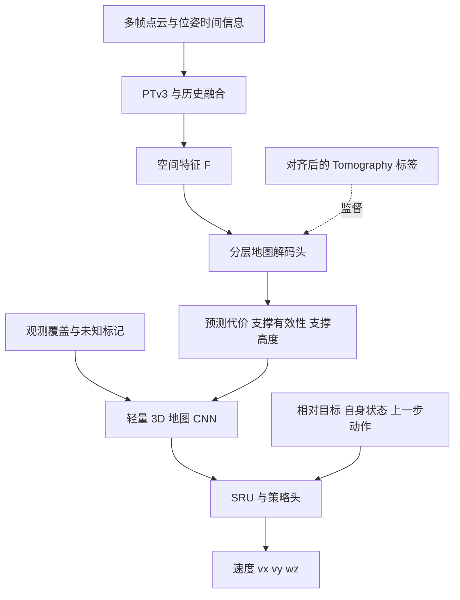
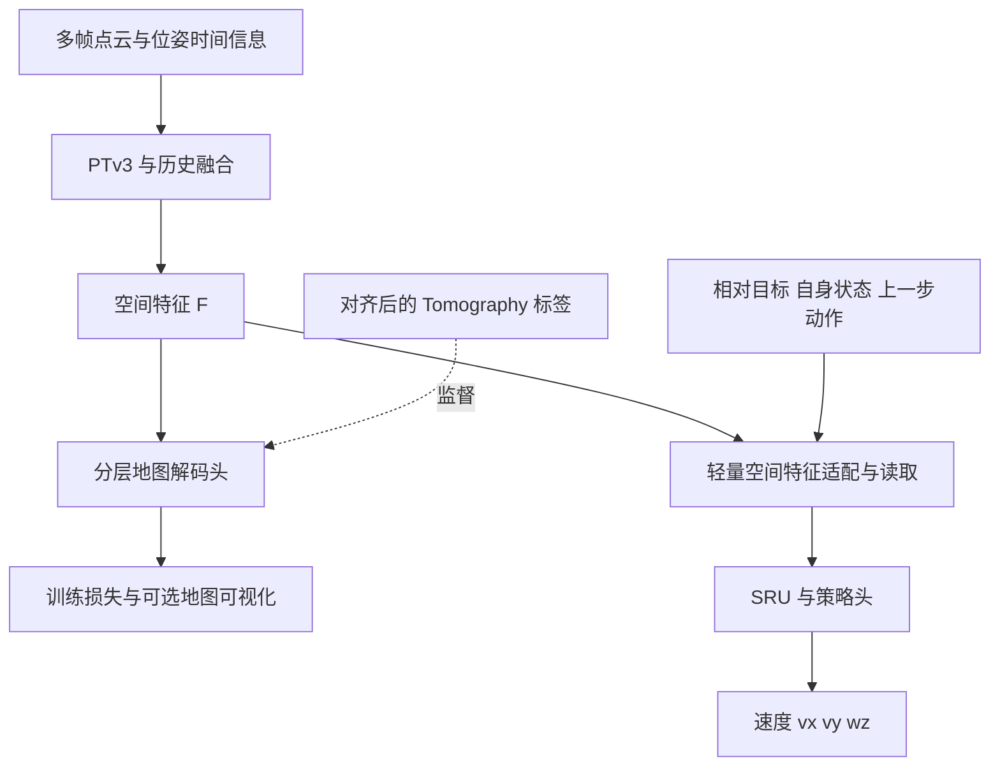

# PTv3 + Tomography：A/B 架构与训练环境备选

**2026-11-04当前实施：用户先推进Plan A的单帧PTv3显式地图前端。完整模型已在4060完成一轮训练，130帧cost/重力高度地图和输入端观测标记已导出，见[Plan A地图](PLAN_A_LOCAL_MAPS.md)。暂不推进地图CNN或SRU。本文后续较早备选与限额描述保留为历史设计，不覆盖当前任务确认表。**

记录日期：2026-11-04。状态：设计记录与环境选型，尚未实现或验证本文的新架构。用户本轮要求先记录和讨论，暂不修改训练代码。

数据生产、标签可靠性、共同预训练及 A/B 导航接入顺序见 [训练实施流程](TRAINING_WORKFLOW.md)。该流程允许先跑通可靠子集的训练链路，支撑标签未核验的区域保留掩码，不作为确定真值。

目标是无先验地图的长程跨楼层导航。训练时允许用完整场景生成 Tomography 监督和 VST 教师，部署时 Actor 只能使用传感器、可估计的自身状态、目标和历史。

## 当前确认的主架构：单帧 PTv3 + SRU

用户确认的主链是：

[查看完整框架图](figures/ptv3_sru_navigation.png)（另有 [SVG 矢量版](figures/ptv3_sru_navigation.svg)）。

按当前单帧前端和 SRU 时序约定重新绘制的对照：[Plan A：显式预测地图](figures/plan_a_single_frame_sru.png)；[Plan B：直接读取空间特征](figures/plan_b_single_frame_sru.png)。Plan B 是当前主线，Plan A 作为显式地图接口备选。两者可共用 PTv3 + cost/高度预测头预训练；导航阶段 A 运行冻结的预测头，B 可将该头仅用于诊断。均不把当前未核验的支撑作为训练输出。

```text
当前帧 LiDAR → 预训练 PTv3（导航阶段冻结）→ 空间特征 F_t
                                                 ↓
相对雷达 odom、时间差、目标和机器人状态 → 空间特征适配
                                                 ↓
                                    SRU（保留 h、c）→ Actor → 速度
```

PTv3 处理当前帧的有效雷达系点；其预期接口是带坐标的空间 token，例如一帧输出 `xyz:[M,3]` 与 `features:[M,C]`，以及批次/有效性信息。M 随有效点和采样层而变化，C 由选定实现和输出层决定；本项目尚未接入 PTv3，尚无经过验证的具体 M、C 或 checkpoint。这些通道是学习到的特征，不能预设某一通道必然代表坡度或障碍物。

离线感知预训练时，将 F_t 送入辅助解码头，使用与**当前帧观测**匹配的 Tomography cost、相对地面高度及独立掩码训练 PTv3 和解码头。首版支撑监督关闭。导航阶段冻结 PTv3 参数，解码头可用于诊断，空间适配、SRU、Actor/Critic 继续训练。冻结参数不冻结输出；F_t 随当前点云变化。

在线每个控制步输入当前帧及与上一帧的雷达相对位姿/时间差，并携带 SRU 上一步的 h、c。训练时按时间顺序展开多个单帧步；只在 episode 结束时重置相应环境的状态，连续重叠窗口不能在保留状态的同时被重复递推。独立历史 Attention 不属于当前主链，可作为未来单独对照。

用户已明确以当前雷达为参考；D1 v1 标签实际位于机身原点、重力/yaw 对齐系。D1-R0 需要统一输出参考系、倾斜雷达下的网格轴与物理高度含义，并重做标签配对和验收。单帧感知预训练需使用当前帧对应掩码，不能沿用 K=8 历史覆盖掩码。v2 数值配对和逐帧 loader 已实现，原生检查的资源验收尚未完成；已通过P1-T1微型官方PTv3监督训练与恢复（历史验收入口已归档），实际SRU执行仍未接入。数据检查保持3帧CPU受限，训练/恢复按用户要求全程6GiB硬限制。

以下第 1–4 节保留早期 A/B 与历史 Attention 备选作为记录；当前实施以本节和任务确认表为准。

## 1. 早期备选：两种方案共同的前端

```text
历史窗口内逐帧同步的 LiDAR 点云、雷达自身 odom、时间戳、观测有效性
    ↓
共享 PTv3：提取每帧空间特征，保留特征对应的坐标
    ↓
雷达相对位姿 / 相对时间编码 + 历史 Attention 融合
    ↓
以当前雷达为参考的空间特征 F
```

输入契约澄清（2026-11-04）：一次输入为 `H_t={(P_i^S_i,T_O_S_i,t_i,valid_i)}，i=t-K+1..t`。`P_i^S_i` 是该帧原始雷达系点云；`T_O_S_i` 是同一 odom 参考系 O 下雷达自身的完整位姿（位置和姿态），不再额外乘机身到雷达外参。这里的“雷达 odom”说明位姿描述的是雷达，并不表示不同时间的雷达坐标轴已经重合。

窗口内构造 `DeltaT_i=inv(T_O_S_t)@T_O_S_i`、`age_i=t_t-t_i`；当前帧为单位矩阵和零时间差。历史融合使用这些关系：可先变换历史 token 的坐标，也可通过相对空间/姿态编码实现关联，不要求把所有输入先转换到世界坐标。PTv3 特征值不被假设对旋转/平移自动等变。时间戳是输入特征，cost/地面高度才是当前预训练监督标签。

本轮明确的输出参考约定是当前雷达系 S_t。已有 D1 v1 包的标签仍采用机身原点、重力/yaw 对齐的 L_t，不能直接称为雷达系标签；当前 loader 的 `relative_sensor_poses` 也是 `T_L_t_S_i`。雷达参考系接口与标签迁移列为 D1-R0，在 P1 前完成。迁移已生成独立 v2 包并通过数值检查，资源中断后的原生验收仍未完成；既有 D1 v1 记录只对应原契约。默认使用2GiB硬限制的小检查入口，不自动启动原生渲染或训练。

PTv3 是当前选定的点云编码器。首版不额外引入 VAE 的随机 latent 或 KL 损失。Attention 负责从对齐后的历史中读取证据，不替代点云编码器，也不保证自动解决长程 POMDP。

F 是保留空间位置的特征集合，建议用固定局部空间 query 读取点特征，得到带坐标的 token。不要在历史融合前把整帧点云压缩成单个全局向量。特征通道数、空间分辨率、局部范围和历史长度在显存与延迟实测后确定。

感知前端以几何观测为条件。目标的相对位置，包括高度差 Δz，在导航分支加入，不改变同一位置的物理通行标签。短历史融合用于补齐观测，SRU 用于保留导航决策历史。跨楼层拓扑记忆和 EROI 前沿探索作为后续独立扩展。

## 2. 早期备选 A：显式地图接口



策略读取预测地图经过 CNN 编码后的特征。推理时必须运行地图解码头和地图 CNN。

建议地图接口为 `[B, C, L, H, W]`。B 是批量，L 是高度切片，H/W 是水平网格，C 首版包括通行代价、支撑存在概率、实际支撑高度以及观测覆盖信息。L 不表示历史帧数，切片索引也不等于真实地面高度。

3D CNN 在水平与高度维度提取局部结构关系，输出导航特征，其输出没有需要逐元素匹配的 Tomography 真值。Tomography 监督作用在地图解码结果上，地图 CNN 由导航任务训练。前几层避免过早压缩高度维度，以免合并桥上、桥下或相邻楼层。

优点是地图可检查，感知与控制接口清楚，也可以在隔离诊断中替换地图来源。代价是地图解码后再次编码，以及地图通道未表达的信息会丢失。3D CNN 是候选实现，并未证明一定优于把分层地图作为通道的 2D CNN。

## 3. 早期备选 B：辅助地图监督



策略直接读取 F，经轻量适配后结合目标和状态进入 SRU。适配可采用保留位置编码的投影和目标条件读取，不必再解码成地图后用 3D CNN 编码。

**B 同样使用 Tomography 监督。** 地图损失经解码头反向更新 PTv3 和历史融合模块，使 F 包含通行几何信息。B 不等于只依赖导航成功奖励来学习点云。

地图解码头用于感知预训练，也可保留作诊断。导航推理可以跳过这个分支。优点是保留地图之外的几何信息，并省去必需的地图解码与再编码步骤。代价是策略仍可能利用训练场景的偶然特征，地图预测准确也不能证明策略实际使用了这些证据。

## 4. 早期备选的 A/B 比较与冻结方式

| 项目 | A：显式地图接口 | B：辅助地图监督 |
| --- | --- | --- |
| 感知预训练 | PTv3 + 历史融合 + 地图解码头 | 完全相同，可共用 checkpoint |
| 策略的感知输入 | 预测地图的 CNN 特征 | 空间特征 F |
| 地图解码头是否必须在线运行 | 是 | 否，可为可视化开启 |
| 导航新增模块 | 地图 CNN、SRU、Actor/Critic | 特征适配、SRU、Actor/Critic |
| 主要约束 | 地图表达能力与预测误差 | 表征可解释性与捷径过拟合 |
| 当前建议 | 保留为明确物理接口的对照方案 | 优先搭建的候选方案 |

B 的实现路径预计更短，但谁的成功率更高必须通过对照实验判断。

共同训练顺序：

1. 用多建筑、多视角序列训练 PTv3、历史融合和地图解码头。首版只设置代价、支撑存在性、支撑高度三组监督。
2. 保存共同感知 checkpoint。冻结 PTv3 和历史融合，A 同时冻结地图解码头。分别训练地图 CNN 或特征适配模块，以及 SRU、策略与价值网络。
3. 导航训练沿用完整 VST 路径教师的 BC/DAgger，以及当前 PPO/PGCL 流程。冻结时导航损失不会更新感知前端。
4. 得到稳定基线后，再比较是否需要小学习率联合微调。联合微调时保留地图辅助监督，控制表征漂移。

冻结的是参数，不是运行时历史。点云缓存、相对位姿对齐和 SRU 状态仍随观测更新。A 的冻结地图解码器在推理时仍运行，B 的解码分支可关闭。

## 5. Tomography 标签与输入对齐

### 5.1 坐标、切片与来源

当前主链按本文首节逐步输入雷达点云、雷达相对 odom 与时间差；训练序列中的每一步只编码对应的当前帧。历史由 SRU 状态携带。

Tomography 配对仍需用当前 query 对应的世界位置查询教师，但世界位姿只供离线配对和构造相对关系，不作为绝对位置输入给 Actor。保留米制尺度，不对每个场景分别做单位球归一化；记录源切片及实际表面高度，不能跨楼层插值或借用另一层代价。

已有 D1 v1 的输出格心与高度在机身重力/yaw 系 L_t，属于原始版本。新的当前雷达系地图接口需在 D1-R0 明确网格轴、高度带和地面高度的定义并重新配对验收：当前雷达安装 pitch=45°，传感器 Z 分量不能直接当成重力方向的地面高度。保留重力信息，空间坐标的表达与物理高度含义分别定义。

同一个 XY 可能有多个支撑高度，必须保留分层。局部高度切片与世界切片的映射需要明确记录，不能用最近 XY 的最低代价直接压成单层。

现有 [VST 导出实现](../../stair_nav/planning/vst.py) 保存的 `data` 为 `(5, L, X, Y)`，通道依次是代价、X/Y 梯度、地面高度、顶面高度，并带有 `resolution`、`center`、`slice_h0`、`slice_dh`。首版预测通道不要求照搬全部五通道。

### 5.2 监督语义

| 字段 | 首版解释 | 损失适用范围 |
| --- | --- | --- |
| traversal_cost | 含骨架影响的 VST 连续通行代价 | 标签有效且观测上下文足够的单元，保留高代价负例 |
| support_validity | 对应切片是否有有效几何地面 | 已有观测依据的有效/无效支撑区域 |
| support_height | 对应支撑面的实际局部高度 | 仅在有效支撑且标签可靠时回归 |
| observed/unknown | 来自射线、历史覆盖和有效性的信息 | 与支撑概率分开记录，不把未观察当空地 |

`valid_ground` 描述几何地面有效性，不等同于足式机器人一定能落脚、保持平衡或完成穿越。VST 是监督教师，其机器人尺寸、阈值和几何近似决定标签含义。

代价与高度可先用带掩码的 Huber 损失，支撑存在性用带掩码的 BCE。各项按有效单元数归一化，代价按固定、记录在数据集中的尺度归一化，权重通过验证集确定。无有效监督的 batch 不把掩码外单元补成零标签。

### 5.3 缺测、未知与负例

- 当前帧缺测、历史曾观察：用历史几何监督恢复，检验多帧融合是否有用。
- 人工稀疏或丢点：从保留的干净观测生成配对标签，同时记录缺失模式。
- 整段历史都被遮挡：保留未知，首版不把隐藏地形当作已观测事实强制监督。若以后做补全，应单独定义推断置信度与评价。
- 有高代价或无支撑：保留障碍、孔洞、窄桥边缘等负例。支撑无效为零标签时，需要有足够的观测或几何可见性依据，不能仅因无回波就判定无地面。
- 骨架代价可能依赖窗口外结构。对上下文不足的单元标记损失掩码或单独评估，避免要求局部观测精确恢复不可见的全局布局。

**奖励的 `None → 0` 规则不等于感知标签“安全”。** 现有 [选层与代价查询](../../../isaac_training/src/isaac_nav/simulation/navigation_surface.py) 的 `match_best_layer` 会过滤超过阈值的层。感知数据不能只保留这个函数返回的低代价层，否则会丢掉最需要学习的障碍负例。监督数据应导出原始各层代价、有效性和高度，独立构造掩码。

## 6. 适合使用的 env

这里的 env 指仿真环境与训练场景。感知预训练首先需要可控的完整三维几何、传感器观测序列和标签，不要求一开始就运行完整关节动力学。

| 候选 | 最适合的阶段 | 可复用能力 | 需要补齐的部分 |
| --- | --- | --- | --- |
| 本项目场景生成器 + Warp M0 | 感知预训练与导航基线，优先选择 | 多层建筑、斜坡/楼梯、孔洞/桥梁、VST 标签，以及已有 M0 执行 | 训练用批量 LiDAR、序列数据导出、多建筑划分与采样 |
| Isaac Lab + 自定义多层 mesh | 完整四足接触下的导航验证与微调 | 四足速度跟踪任务、接触仿真、批量射线传感器 | 跨层任务、A1 低层控制器、MID-360 扫描模式、同一套 VST 标签接口 |
| Habitat-Sim + HM3D | 陌生建筑的感知泛化与高层导航评估 | 真实室内扫描、楼层元信息、导航基础设施 | 筛选可连接的跨层场景、mesh 质量检查、自定义 LiDAR/VST 接口 |
| ETH terrain-generator | 扩充可控的三维几何训练素材 | WFC 网格模块组合 | 接入本项目的数据格式、重新生成 VST 标签、增加任务和跨层连通约束 |

### 6.1 第一选择：沿用现有场景与 Warp

现有 [随机建筑入口](../../../scripts/scenes/generate_random_map.py)、[侧边斜坡平台](../../../scripts/scenes/generate_ramp_platform.py) 和 [Warp 执行](../../../isaac_training/src/isaac_nav/geometry/warp_execution.py) 能复用。建议把感知数据生产独立出来：

```text
随机完整 mesh → 干净几何点云 → VST Tomography 标签
       ↓
采样运动中的传感器位姿序列
       ↓
批量射线 + 扫描时序 + 缺测/噪声 → 多帧 LiDAR 输入
       ↓
相同局部坐标系的输入与监督 → A/B 共同感知预训练
```

现有 [网页 LiDAR](../../stair_nav/visualization/lidar.py) 使用 Open3D 射线查询，属于 CPU 预览路径。其 [配置](../../../configs/lidar_mid360.json) 明确为瞬时 mesh 首次命中，不含滚动扫描畸变、反射率、噪声或机器人自遮挡。M0 已有 GPU 执行，不意味着训练用 GPU MID-360 已经接好。

后续实现时可用 Warp 做批量传感器射线，并对接扫描方向表。先保证外参、重力方向、射线时间和缺测标记正确，再逐项加入噪声、扫描畸变和位姿误差。独立保存干净标签与退化后的输入。

导航仍可先在已有 M0 里训练。M0 的支撑与机身碰撞结果只验证降阶模型，不代替完整四足接触测试。

### 6.2 Isaac Lab：完整机器人阶段

官方提供 `Isaac-Velocity-Rough-Unitree-A1-v0` 等速度跟踪任务，可作为低层运动控制的起点。`Isaac-Navigation-Flat-Anymal-C-v0` 是平面目标导航示例，可借鉴高低层接口，但仍需要自定义跨层目标、地形和观测。[官方环境列表](https://isaac-sim.github.io/IsaacLab/v2.2.1/source/overview/environments.html)

对于本项目，高层继续输出 `[vx, vy, wz]`，低层由已验证的足式控制器执行。先固定低层能力，再评估高层选路，以便区分感知错误、导航错误和步态能力不足。

官方 RayCaster 支持可配置射线方向和批量结果，所查 v2.2.1 文档说明采用 Warp 加速，并有静态 mesh 限制。通用 LiDAR pattern 需要适配 MID-360，不能视为原生精确传感器模型。[RayCaster 文档](https://isaac-sim.github.io/IsaacLab/v2.2.1/source/overview/core-concepts/sensors/ray_caster.html)

跨层场景必须保留三维 mesh。单值 heightfield 无法同时表达同一 XY 的桥上、桥下和顶棚。导入时检查碰撞网格与传感器网格一致，以及复制环境的坐标偏移。具体 API 按最终锁定的 Isaac Lab 版本实现。

### 6.3 Habitat-Sim + HM3D：陌生建筑测试

HM3D 提供真实建筑尺度的室内扫描及楼层数量信息，适合补充程序生成场景的形态差异。应挑选确实具有连通楼梯或坡道的多层子集，检查扫描孔洞和台阶质量。[HM3D 官方数据页](https://aihabitat.org/datasets/hm3d/)

Habitat 的 NavMesh 通行性由 agent 的半径、高度、最大台阶与坡度参数决定，不能直接当作本项目机器人和 VST 的真值。应从场景 mesh 重新产生所需标签。[NavMeshSettings](https://aihabitat.org/docs/habitat-sim/habitat_sim.nav.NavMeshSettings.html)

建议先将这些场景用于感知域外测试，必要时再接高层导航。默认 PointNav/NavMesh 行走不能证明真实四足能完成接触运动。MID-360 输入还需要自定义射线或 mesh 采样接入。

### 6.4 ETH terrain-generator：增加几何变化

该工具使用 WFC 组合 mesh 模块，并检查模块连接关系。它可作为额外场景资产生成器，不能直接替代完整导航训练环境。[官方仓库](https://github.com/leggedrobotics/terrain-generator)

对本项目的价值是增加布局、窄通道、上下结构组合的变化。生成后仍需用统一机器人配置重新构建 VST，并验证目标间是否存在所需跨层连接。当前本项目生成器与该外部工具应分别标识，避免混淆代码来源。

## 7. 训练场景首先应该覆盖什么

| 成对场景 | 要学到的区别 |
| --- | --- |
| 同一平台的侧边缓坡入口与垂直侧壁 | 上方存在平面不代表当前方向可以登上 |
| 可通过楼梯与过高踏步/过陡坡 | 判断连续几何能力边界，而不是只识别楼梯类别 |
| 宽桥与过窄桥 | 支撑宽度、边缘与机身空间共同约束通过 |
| 桥上通道与桥下通道 | 同一 XY 的多层支撑和净空不能合并 |
| 完整通道与中间断开的通道 | 支撑连续性与空洞检测 |
| 当前缺测但历史已观察与一直遮挡 | 从历史恢复证据，同时保留真正未知 |

同一结构应从正面、侧面、上方和下方观察，包含不同距离、朝向和运动速度。序列不仅来自成功教师路线，也应包含偏离路线、靠近障碍和恢复动作附近的状态，减轻部署时的观测分布偏移。

先覆盖可控局部几何，再组合多层随机建筑。上下楼、同层绕行和需要先远离目标才能找到楼梯的路线都应包含。目标高度变化与观测噪声不能固定绑定到某一种场景外观。

训练、验证、测试按建筑 seed 或建筑资产分组，避免同一建筑的相邻帧和不同路线跨集合泄漏。相同建筑的新路线、未见建筑、未见几何组合分别报告。

## 8. 实施顺序与判断依据

建议顺序是：现有 mesh 生成感知数据集 → 共同感知预训练 → 在 Warp M0 对比 A/B → 用陌生建筑测试 → 在 Isaac Lab 验证完整接触。

最小对照使用同一感知 checkpoint、输入历史、建筑划分、路线、教师、奖励、课程和导航训练预算。A/B 各自的策略适配模块不同，其参数量和耗时应一起报告。

- 感知：代价误差、支撑精确率/召回率、支撑高度误差。单独统计把危险区域预测成低代价有效支撑的错误，以及遮挡区域错误自信。
- 导航：仅终点条件下的成功率、机身碰撞、失去支撑/跌落、上楼/下楼分项、长路线完成情况。
- 计算：传感器生成、PTv3、历史融合、地图分支、策略各段延迟及完整吞吐。不能只报 PTv3 前向速度。

只有预测地图好看或训练集 loss 下降，还不足以选定 A/B。先看未见建筑的实际通行行为，再结合耗时决定。

## 9. 保留现有训练约定

- 教师速度标签依据完整 VST 路径，不重新绑定到当前 PGCL 采样点。
- 现有 VST 奖励的选层与 `None → 0` 约定保持。感知辅助损失不自动加入 episode reward，不恢复额外惩罚。
- 保留物理速度、加速度和延迟限制。倒车、横移及到终点无需刹停的任务约定保持。
- 常规执行沿用 GPU 批处理，不加入逐步防御性 CPU 重算。
- 后续若改训练执行、课程或奖励，重跑选层等价性（含 None→0）、同状态八级提示标签一致性、安全探测完整恢复、密集/仅终点 GPU 路线。新增 7 m、10 m 课程也要分别检查提示变化不会改变教师标签。
- 学生效果仍需 BC/DAgger/PPO 新 run 与独立学生执行评估，本设计文档不声称已经提高成功率。

## 10. 软件环境备注

所查 PTv3 官方主分支已提供 PyTorch + Triton 包，并要求 `torch>=2.10`，经典实现保留在 `legacy` 分支。[PTv3 官方仓库](https://github.com/Pointcept/PointTransformerV3)

本仓库当前 [训练依赖声明](../../../isaac_training/pyproject.toml) 的 SRU extra 为 `torch>=2.7,<2.8`，[统一环境配置](../../../environment.yml) 固定 `torch==2.7.0+cu128`。这些是代码声明，不代表本轮检查了所有机器的实际安装环境。

因此，感知预训练先使用独立环境并锁定 PTv3 版本。接入在线导航前再决定兼容实现或显式迁移训练依赖，冻结权重本身不能解决运行时依赖冲突。本轮未安装依赖、下载数据或启动训练。

相关旧设计：[深度输入的通行注意力设计](../../../docs/TRAVERSABILITY_ATTENTION_DESIGN.md)。该文档记录较早的深度 CNN 路线，本文记录新的 LiDAR/PTv3 A/B 候选，不能据此认为已有运行代码已经切换。
